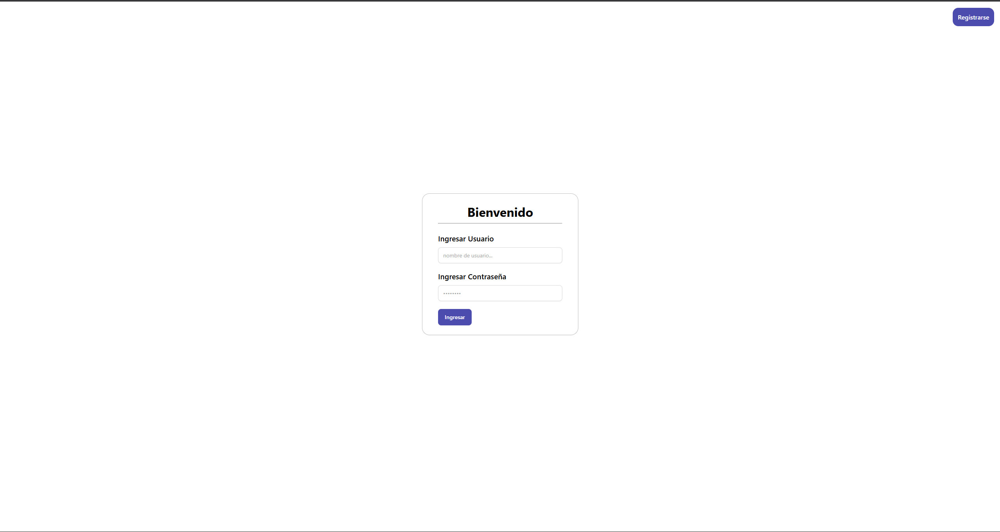
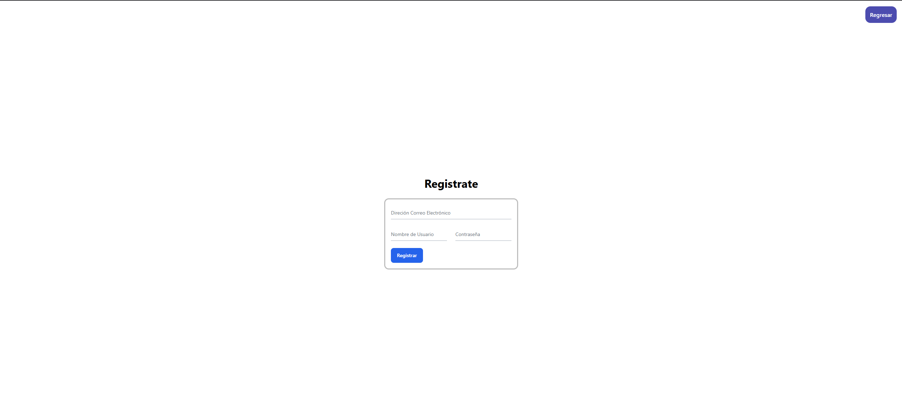

<!-- Para poner imagenes
 -->

## Comandos Importantes

Antes de iniciar con la explicación del montaje del proyecto deberemos de instalar librerias y dependencias, de esta forma el proyecto funcionará de forma correcta y no tendremos problemas con la implementación.

## Base de Datos

Se optó por una implementación en un contenedor de Docker para hacer más sencillo el desarrollo y la puesta a prueba del proyecto final; por lo tanto, es importante tener instalado docker para ejecutar correctamente el proyecto, de cualquier manera existirá un archivo llamado "init.sql" donde se encuentra lo insertado y las tablas de la base de datos.

En la dirección donde se encuentra la carpeta /db, ejecutaremos:

```bash
    docker build -t mysql-image .
```

Y luego:

```bash
    docker run -d --name db -p 3306:3306 -e MYSQL_ROOT_PASSWORD=rootpassword -e MYSQL_DATABASE=app_db -e MYSQL_USER=app_user -e MYSQL_PASSWORD=app_password -v mysql_data:/var/lib/mysql mysql-image
```

Eso probocará que se levante el contenedor que alamacena la base de datos MySQL.

Por si se necesitara detener el contenedor

```bash
    docker stop db
```

Por si se necesitara iniciar nuevamente el contenedor

```bash
    docker start db
```

Por si se necesitara eliminar el contenedor

```bash
    docker rm -f db
```

## Backend

Se creó una API REST con Express, por lo deberemos de tener en cuenta de tener instalado npm y node.js, para comprobar si estan instalados y consultar la version, ejecutaremos:

```bash
    npm --version
```

y

```bash
    node --version
```

Luego instalaremos las dependencias necesarias para el backend, las cuales son:

```bash
    npm install express mysql2 dotenv cloudinary multer cors
```

Para iniciar el backend

```bash
    node App.js
```

## Frontend

Se optó por utilizar Angular, gracias por su practicidad al momento de crear sitios web, como también para pobrar las habilidades de nuestro grupo de trabajo para utilizar un Framework reconocido para la capa de frontend.

Para poder utilizar angular en el cmd

```bash
    npm install -g @angular/cli
```

Para crear el proyecto

```bash
    ng new nombreProyecto
```

Para entrar al proyecto

```bash
    cd nombreProeycto
```

Para iniciarlo

```bash
    ng serve
```

Para crear un componente nuevo

```bash
    ng g c carpeta/nombreComponente
```

Para crear un servicio nuevo

```bash
    ng g s carpeta/nombreServicio
```

## IMPLEMENTACIÓN BASE DE DATOS

Se tomaron en consideracion 4 tablas principales las cuales tendran el control del inventario, usuarios y movimientos dentro del sistema. Las tablas son las siguientes:

<!-- Imagen entidad relacion -->


Para entrar a la base de datos contenerizada:

```bash
    docker exec -it db bash
```

```bash
    mysql -u app_user -papp_password ap_db
```

## Tablas

## User

En la tabla _User_ se alamacenarán los usuarios permitidos dentro del , contendrá los siguientes campos:

- id: identificador único del usuario, será de tipo CHAR(36) y este generará un id tipo UUID.
- name (nombre): nombre del usuario, se guardará en tipo VARCHAR(80).
- password (contraseña): guardará la contraseña del usuarios, se guardará en tipo VARHCAR(12).
- role (rol): guardará el tipo de usuario y limitará las acciones del mismo dentro del sistema, descripción de los tipos de usuarios:
  - _Administración_: será el encargado de llevar el control de ingresos, actualización, obtención y eliminación de elementos (se le llamará de esta manera, ya que no solo se guardan componentes de computadoras, sino también muebles y periféricos).

  - _Consultor_: será un usuario, el cuál solo prodrá consultar los elementos almacenados, solo tendrá acceso a la vista de ellos.

- email: guardará la direccion email del usuario, de vital importancia para el registro de nuevos usuarios, se guardara en tipo VARCHAR(50).

Para consultar la tabla en la base de datos:

```bash
    SELECT * FROM User;
```

## Element

En la tabla _Element_ se guardaran los elementos (productos) alamacenados en el inventario, contendrá los siguientes campos:

- id: identificador único del elementos, tipo INT.
- name (nombre): el nombre del elemento, se guadará en tipo VARCHAR(80).
- description (descripción): una descripción simple del elemento, se guardará en tipo VARCHAR(160).
- quantity (cantidad): la cantidad de elementos en existencias, se guardará en tipo INT.
- entryDate (fecha de entrada): la fecha en la que fue registrado en el inventario, se guardará en tipo DATETIME.
- img: una imagen del elemento guardado, se guardará en tipo TEXT, ya que, la imagen será ingresada en tipo texto y esta guardada en una nube de imagenes (Cloudinary)
- categoryId: llave foránea que hace enlace a la tabla Category, la cual guarda las categorias de los elementos.

Para consultar la tabla en la base de datos:

```bash
    SELECT * FROM Element;
```

## Category

En la tabla _Category_ se guardarán las categorias de los elementos, mencionado anteriormente, contrendrá los siguientes campos:

- id: identificador único de la categoria, será de tipo INT.
- category (categoria): guardará el nombre de la categoria, en los cuales incluye:
  - Computadora
  - Teléfono
  - Mesa
  - Periféricos
  - Sillas
- type (tipo): un nivel más de clasificación en la categoria, en los cuales incluye\_
  - Electrónico
  - Mueble

Para consultar la tabla en la base de datos:

```bash
    SELECT * FROM Category;
```

## Movements

En la tabla _Movements_ se guardarán los diferentes moviemientos en el inventario, insercciones, actualizaciones y eliminaciones, contendrá los siguientes campos:

- id: identificador único del movimiento, será de tipo CHAR(36) y este generará un id tipo UUID.
- type: tipo de movimiento ingresado, será de tipo VARCHAR(15) y puede tener las siguientes opciones:
  - INSERT: insertar elementos nuevo o agregar más cantidad a las existencias.
  - UPDATE: actualización de datos de elemento.
  - DELETE: eliminación permantente o eliminar elementos de las existencias.
- lastModification (última modificación): almacenará la fecha de la ultima modificación del elemento, será de tipo DATETIME.
- newModification (nueva modificación): almacenará la fehca de la modificación que se realizó (hoy), será de tipo DATETIME.
- description (descripción): almacenará una pequeña descripción de que se realizó en el movimiento.
- elementId: llave foránea de la tabla de elementos, asi podremos saber a que elemento se le aplicó el movimiento.

Para consultar la tabla en la base de datos:

```bash
    SELECT * FROM Movements;
```

## IMPLEMENTACIÓN BACKEND

Esta será la interfaz entre la base de datos y la interfaz de usuario, este estará encargado de administrar la base de datos desde los comandos que el usuario indique. Aunque se solicitaron funciones básicas de un CRUD, por temas de mantenimiento de la aplicación y funcionalidades extra se decidieron incluir más las cuales en conjunto serán presentadas:

## /users

Enfocada en el control de los usuarios

- _Obtención de Todos los Usuarios_: como su nombre lo indica será un método de tipo GET, el cuál traerá todos los usuarios ingresados en la base de datos.


- _Obtención de Usuarios por ID_: como su nombre lo indica será un método de tipo GET, el cuál obtendrá al usuario por su ID.


_Error_


- _Registro de Usuarios_: como su nombre lo indica será un método de tipo POST, el cuál ingresará un nuevo usuario, por temas de seguridad solo se podrá registrar usuarios de tipo "consultor".


## /verifyUser

Será el encargado de verificar los usuarios que deseen entrar a la aplicación, será con nombre de usuario y contraseña.

- _Verificación de Usuarios_


_Error_


## /elements

Enfocada en el control de elementos dentro del inventario

- _Obtención de Todos los Elementos_: como su nombre lo indica será el método de tipo GET, el cuál traerá todos los elementos ingresados en la base de datos.


- _Obtención de Elementos por Categoría_: como su nombre lo indica será el método de tipo GET, el cuál traerá todos los elementos ingresados que compartan la misma categoría.


_Error_


- _Obtención de Elementos por ID_: como su nombre lo indica será el método de tipo GET, el cuál traerá el elemento que corresponda con su ID.


_Error_


- _Ingreso de Elementos_: como su nombre lo indica será el método de tipo POST, el cuál ingresará un nuevo elemento a la base de datos.


_Error 1_


_Error 2_


- _Actualización de Elementos_: como su nombre lo indica será el método de tipo PUT, el cuál actualizará el elemento elegido por ID.


_Prueba de Actualización_


- _Eliminación de Elementos_: como su nombre lo indica será el método de tipo DELETE, el cuál eliminará un elemento elegido por su ID.


## /elementsQuantity

- _Aumento/Disminución de Existencias_: como su nombre lo indica será el método de tipo PUT, el cuál actualizará la cantidad de existencias de un elemento por su ID.


_Error_


- _Eliminación de Elementos_: como su nombre lo indica será el método de tipo DELETE, el cuál eliminará un elemento elegido por su ID.


## /moveAll

- _Obtención de Movimientos_: como su nombre lo indica será el método de tipo DELETE, el cuál obtendrá todos los elementos almacenados.


## IMPLEMENTACIÓN FRONTEND

Fue planteado hacerlo con Angular, ya que, facilita muchisimo el desarrollo y supone un mayor esfuerzo para nosotros, de igual manera, se intento hacerlo de la forma más sencilla y comprensible para que inclusive persona que nunca hayan utilizado la aplicación se sientan comodas mientras utilizan el sistema.

Para la implementación del frontend se decidio separar en 6 paginas principales, en las cuales esta repartido todo el contenido necesario para el inventario, las paginas son:

## /

Es la página raíz donde todo el proyecto proviene y este se vería como un login, en el cuál podriamos ingresar un nombre de usuario y contraseña, en el caso tengamos una cuenta asignada o creada anteriormente, y un boton el cual nos permite registrarnos, el cuál de forma predeterminada solamente dejará crear usuarios con el rol de consultor. La pagina deberia verse de esta forma:



## /register

Como se pudo ver en el inicio, existe un boton para registrar nuevos usuarios, el proposito de ese botón es redirigir a esta página, la cuál es encargada de ingresar nuevos usuarios consultores, por motivos de seguridad y no permitir que cualquiera cree una cuenta y pueda tener acceso a toda la información del inventario. La pantalla debería de mostrar una interfaz como esta:



## /home

Luego de haber pasado la parte de usuarios, finalmente podemos ver la página principal, la cual servirá como eje central de todas las funciones que posee el sistema de inventario. El apartado de inicio tendrá las siguientes funcionalidades y vistas:

_"La mayoría de las funciones no serán visibles para un usuario consultor"_

- Al momento que entremos notaremos que los elementos estan listados como lo hacen en una tienda en línea, esto se hizo de esta forma para tener más facilidad para encontrar diferentes elementos, ayudados de una imagen y de la información importante del elemento.
- Los elementos pueden ser mostrados por categorias, esto permitirá que los usuarios puedan hacer busquedas más rápidas dependiendo de lo que esten buscando en ese momento.
- Ingreso de elementos existentes, se especificó de esta forma, ya que se podrán agregar a existencias más elementos, siempre y cuando este elemento haya sido creado con anterioridad.
- Ingreso de elemetnso nuevos, esta función permite redirigir a la página "/insert-element", en la cuál se realizará la inserción.
- Historial, este botón redirigirá a la página "/history", la cuál mostrará el historial de moviemientos en el sistema, inserciones, eliminaciones y actualizaciones que se haga al inventario.
- Regresar, botón el cuál permitirá cerrar sesión y salir del sistema.
- Tarjetas de elementos, cada tarjeta contará con la información de cada uno de los elementos de una forma semi-detallada, además contarán con un boton el cuál redirigirá a la página "/element/id", la cuál mostrará un mayor detalle del elemento.

En la siguiente foto se verá la interfaz para un usuario Administrador:


En la siguietne foto se verá la interfaz para un usuario Consultor:


## /element/id

En esta página se verá un vistazo más detallado del elemento selecionado, en el cuál podremos ver más información y prodremos interactuar de mejor manera con el elemento, a continuación se listarán las funciones y vistas posibles:

_"La mayoría de las funciones no serán visibles para un usuario consultor"_

- Actualizar, este botón habilitará el modo edición, el cuál permitirá cambiar la información almacenada en la base de datos sobre el elemento, se registrará un movimiento luego de realizar la acción.
  - En este modo veremos la siguiente vista:

    Para la cuál tambien tendremos un botón para desactivar el modo edición.
    

- Eliminar, este botón lanzará una pregunta al usuario si realmente desea eliminar el elemento, si la respuesta es positiva, el sistema eliminará de manera permanente el elemento y si se desea ingresar nuevamente tendrá un id distinto, esta acción registrará un movimiento luego de aplicarse.

  En el caso se desee eliminar permanentemente:
  

  Respuesta
  

- Disminuir cantidad, este botón permitirá ver una vista nueva en la cuál consulta la cantidad de elementos a eliminar, es importante saber que solo se realizará la acción si la cantidad no es mayor a las existencias, esta acción se registrará como movimiento al ser satisfactoria.

  En el caso se desee eliminar elementos de las existencias:
  

  En el caso ocurra un error:
  

- Regresar, este botón permite regresar a la vista general donde se encuentran todos los elementos.

En la siguiente foto se verá la vista para un usuario Administrador:


En la siguiente foto se verá la vista para un usuario Consultor:


## /insert-element

En esta página ocurrirá el proceso de ingreso de elementos al inventario, al ingresar se permitirá ingresar:

- Una imagen representativa
- Nombre
- Una descripción
- Cantidad en stock a agregar
- Su categoría
- Su tipo dentro de las categorias

Se debería de ver esto al tener todos los campos llenos


En el caso ocurra un error al intentar ingresar un elemento nuevo


Si el ingreso fue satisfactorio


## /history

En esta página se mostrará todo los movimientos que se han hecho en el sistema, como eliminaciones, actualizaciones o ingresos de elementos. En la página se mostrarán de la siguiente manera:

Durante toda esta explicación se estuvieron guardando los datos que se mostrarón por lo tanto se mostrará una foto del historial antes de realizar todos los cambios y después

_Antes_

_Después_


## /not-found

Página con el único proposito de mostrar que la página a la que se intento ingresar no existe y que ocurrio un error, permitirá regresar a la página principal en caso fue un error.

